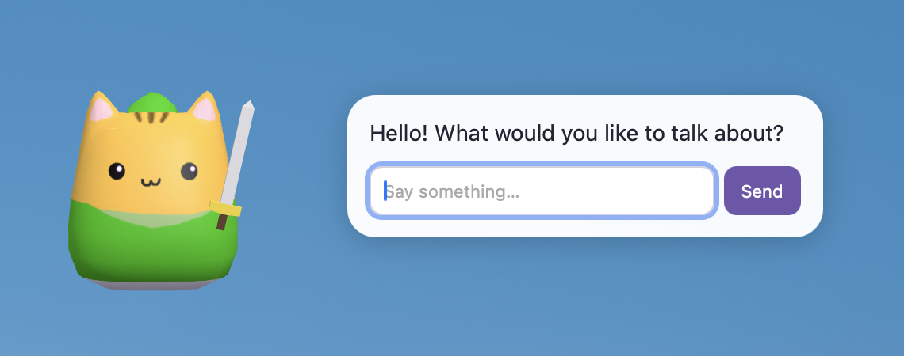

# LAI - Local AI



LAI is an opinionated local agent harness on Apple Silicon for developers who are tired of being cucked by the AI overlords.

## Developer Quickstart

1. [Install Rust](https://rust-lang.org/tools/install/) 
```sh
curl --proto '=https' --tlsv1.2 -sSf https://sh.rustup.rs | sh
```

1. Install dev dependencies, Xcode, and Metal toolchain if not already installed
```
xcode-select --install
xcodebuild -runFirstLaunch
xcodebuild -downloadComponent MetalToolchain

brew update
brew install cmake

```

1. Build
```sh
cargo build --release
```

1. Test
```sh
cargo nextest run
```

1. Download a `mlx` friendly HuggingFace model. This model will be saved under `~/.lai/models/<owner>/<model>/`.
Models may not run if they're not `mlx` compatible. 
You may also need to set a huggingface token for private models on huggingface.

```sh
lai key set huggingface
lai download "DreamFoundries/supergemma4-e4b-abliterated-6bit"  # LLM
lai download "mlx-community/embeddinggemma-2-5bit"              # Embedding model
```

1. Test out the model
```sh
lai config model set "DreamFoundries/supergemma4-e4b-abliterated-6bit"
lai serve -d -p
```

## Documentation

### Structure
- MLX for Local Inference
- SQLite for Memory
- Embedding Model for Memory embedding. [We use EmbeddingGemma2 as a default](https://ai.google.dev/gemma/docs/embeddinggemma)
- Local LLM Model. [We use DreamFoundries/supergemma4-e4b-abliterated-6bit as a default](https://huggingface.co/DreamFoundries/supergemma4-e4b-abliterated-6bit)


### Logging

LAI writes logs to standard error at `info` level by default. Set `RUST_LOG` to control verbosity, for example `RUST_LOG=lai=debug lai download owner/model` or `RUST_LOG=lai=warn lai download owner/model`.

### Key and Secret Management

LAI uses the Apple Keychain to store secrets. `.env` variables in the repository is only present for the purpose of debugging and development.

```sh
lai key set huggingface
lai key rotate huggingface
lai key unset huggingface
```

### Select a model

After downloading a model, configure which model LAI should use:

```sh
lai config model set "DreamFoundries/supergemma4-e4b-abliterated-6bit"
lai config model update "owner/another-model"
lai config model unset
```

### Configure the memory model

Configure the embedding model separately from the chat model:

```sh
lai config modelMemory set "mlx-community/embeddinggemma-2-5bit"
lai config modelMemory update "owner/another-embedding-model"
lai config modelMemory unset
```

Setting a model offers to download it if it is missing. LAI uses
`mlx-community/embeddinggemma-2-5bit` by default when no memory model is set.
The current embedding runtime supports EmbeddingGemma 2 models.

Memory embeddings run locally in a persistent MLX Python worker. Install its
runtime once using Python 3.10 or newer:

```sh
python3 -m venv ~/.lai/embedding-venv
~/.lai/embedding-venv/bin/python -m pip install 'mlx==0.32.4' 'transformers==5.22.1' 'mlx-lm==0.32.2' requests Pillow sentencepiece jinja2 numpy
~/.lai/embedding-venv/bin/python -m pip install --no-deps 'git+https://github.com/Blaizzy/mlx-vlm.git@3d87e88402f307efbf68e568971aa887ee7d9ed0'
```

Alternatively, set `LAI_MEMORY_PYTHON` to a Python interpreter with those
packages installed. Restart the server after changing the model or runtime.

### Serve the selected model

Building the MLX backend requires CMake, Xcode with the Metal toolchain, and an Apple Silicon Mac. Select and download a supported MLX model first, then run:

```sh
lai serve                 # foreground, Ctrl-C to stop
lai serve -d              # background; logs go to ~/.lai/serve.log
lai serve -p              # show the desktop cat while serving
lai serve -p -d           # run the server and cat in the background
lai serve --port 8081     # choose a different local port  (default: 8989)
lai kill                  # kill an existing lai serving in the background
```

`lai kill` asks the detached server to stop after its current request finishes. It does not stop a foreground server. 

The `-p or --pet` flag will spawn a pet on your screen.
Click on it to open chat. 
The cat displays its reply beside it. 
Right-click the cat and choose other actions.
Chat history is persisted as a default and is stored in `~/.lai/memories`

Configure the pet with the CLI. Relative model paths are resolved from `~/.lai`,
and animation values are clip names in the GLB:

```sh
lai config pet model set my-pet.glb
lai config pet animation set shutdown Sleep
lai config pet animation unset shutdown   # restore the default
lai config pet model unset                # restore the bundled cat
lai config pet show
```

The settings are stored alongside the other settings in `~/.lai/config.toml`.
Omitted settings use the bundled cat and the defaults shown here:

```toml
# [pet]
# model = "my-pet.glb"

[pet.animations]
idle = "1_normal"
waiting = "6_curious"
reply = "2_happy"
error = "3_sad"
shutdown = "3_sad"
```

The server listens only on `127.0.0.1`, with default base URL `http://127.0.0.1:8989/v1`. 

The API exposes `GET /v1/models`, `POST /v1/chat/completions`,
`POST /v1/completions`, and `POST /v1/responses`.

The Responses endpoint accepts a text `input` string or an array of text
messages, optional `instructions`, `temperature`, `max_output_tokens`, and
`stream`. Input can include `user`, `assistant`, `system`, and `developer`
messages; `developer` is mapped to `system`. Text content parts use `input_text`
for input and `output_text` for assistant messages. Send prior messages again
for multi-turn conversations. Responses are not stored; `store: true`,
`previous_response_id`, tool calls, and multimodal content are unsupported and
rejected. `max_output_tokens` defaults to 256 and must be 1–4096.

With `stream: true`, the server returns Responses API server-sent events after
generation finishes, with the generated text in one delta. This is not
incremental token streaming. When the token limit is reached, the response has
status `incomplete` and reason `max_output_tokens`.


Set a default system prompt for chat requests, including the desktop pet:

```sh
lai config systemPrompt "You are a friendly and concise assistant."
lai config systemPrompt ""  # clear the default
```

Restart `lai serve` after changing it. An explicit system message in a chat
request or `instructions` or a system/developer message in a Responses request
takes precedence. The raw completions endpoint uses its supplied prompt.

Use the configured Hugging Face model ID in the `model` field:
```sh
curl http://127.0.0.1:8989/v1/chat/completions \
  -H 'Content-Type: application/json' \
  -d '{"model":"DreamFoundries/supergemma4-e4b-abliterated-6bit","messages":[{"role":"user","content":"Hello!"}],"max_tokens":128}'
```

A helper script is in `./script/completion.sh` to test out the flow.
```sh
./script/completion.sh "Hello!"
```

The script discovers the loaded model automatically. Set `LAI_BASE_URL` if the server uses a different address, for example `LAI_BASE_URL=http://127.0.0.1:8081/v1 ./script/completion.sh "Hello!"`.

### Speculative decoding

For a compatible Gemma 4 model, enable speculative decoding with:

```sh
lai config speculativeDecoding true
```

LAI stores the setting in `~/.lai/config.toml` and offers to download the Gemma 4 E4B assistant if needed. To use a different compatible, unquantized Gemma 4 assistant, supply `--draft-model owner/model` when enabling it. Restart `lai serve` after changing the setting. Disable it with:

```sh
lai config speculativeDecoding false
```

The draft model uses additional memory, and performance depends on the model and workload. The server logs the number of accepted draft tokens. Speculative decoding currently supports greedy generation only: omit `temperature` or set it to `0`; requests specifying a different temperature are rejected. When disabled, the server uses normal decoding.

### Memory

Memory is enabled by default for chat completions, Responses, and pet chat. All
local chat clients share the selected profile. After a successful response, LAI
queues the most recent user message in `~/.lai/memories/default.sqlite` and uses
the loaded model to extract selected facts while idle. Queued text survives a
restart and is removed after successful extraction. Saved facts include their
supporting text. The raw completions endpoint does not use memory.

```sh
lai config memory enabled false          # disable memory; restart the server
lai config memory enabled true           # enable it again
lai config memory profile work.sqlite    # switch profile; restart the server
lai memory list
lai memory show 1
lai memory delete 1
lai memory clear                         # also removes pending jobs
```

LAI embeds memories and queries using the configured local embedding model and
retrieves similar memories with SQLite-Vector. Existing memories are embedded
in the background; changing model files causes them to be re-embedded. If the
embedding model or runtime cannot load, the server logs a warning and continues
without memory retrieval. Extraction depends on the chat model producing valid
JSON. A job that repeatedly fails remains queued and is retried. Extracted facts
may be wrong or outdated; inspect and remove them as needed.
SQLite may create WAL and shared-memory files alongside the database; use
SQLite's backup API or a database-aware backup tool for a consistent backup.
